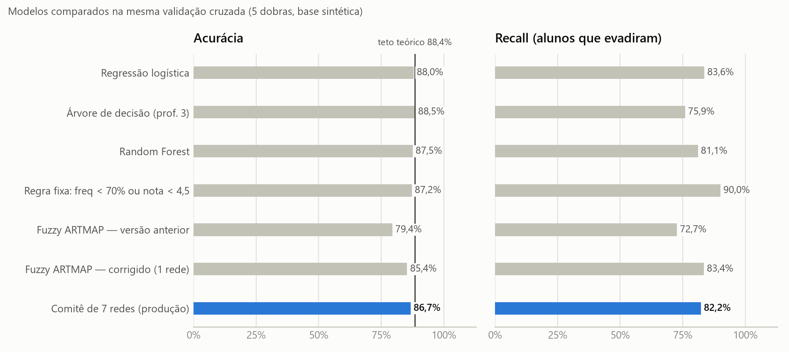
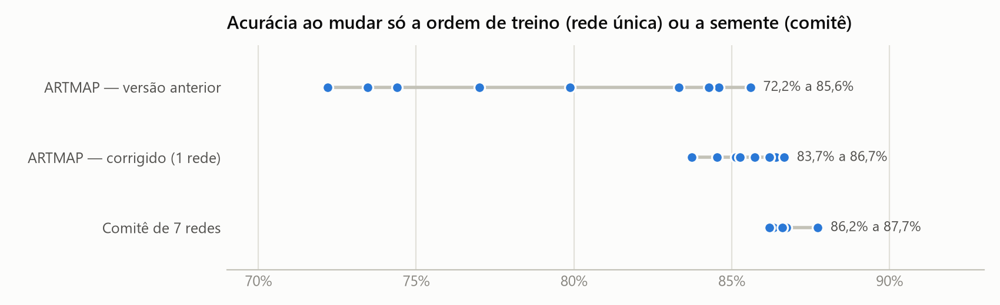
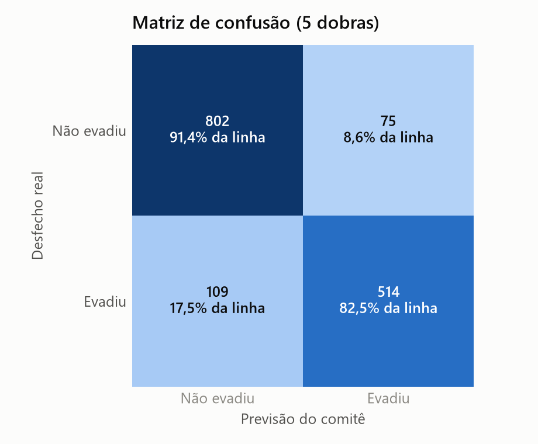
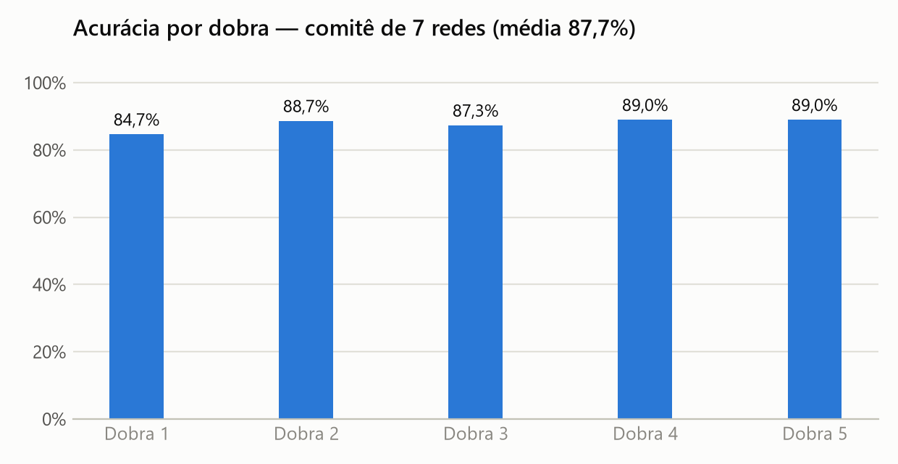

# Avaliação do modelo de predição de evasão

Gerado por `treinar_modelo.py` em 13/10/2026 15:36. Base: **1500 alunos sintéticos**
(41,5% evadiram), validação cruzada estratificada com 5 dobras (`random_state=42`, a mesma
divisão do experimento original do TCC). Versão do modelo publicado: `20261013-1836-e0dbfb`.

> **Limitação principal:** a base é **sintética**, gerada por regras (`gerar_dados_ficticios.py`). No gerador,
> alunos "medianos" evadem 30% das vezes e "anomalias" 50% *ao acaso*, então existe um **teto teórico de
> 88,4%** de acurácia (erro de Bayes) que nenhum modelo supera. Os números abaixo medem o quanto cada
> modelo redescobre as regras do gerador — não o desempenho em alunos reais (ver `validar_base_publica.py`).

| Modelo | Acurácia | Precisão | Recall (evadiu) | F1 | AUC | Observação |
|---|---|---|---|---|---|---|
| Chutar 'ninguém evade' | 58,5% | 0,0% | 0,0% | 0,000 | — | referência mínima |
| Regressão logística | 88,0% | 87,0% | 83,6% | 0,853 | 0,961 |  |
| Árvore de decisão (prof. 3) | 88,5% | 95,6% | 75,9% | 0,846 | 0,952 |  |
| Random Forest | 87,5% | 88,0% | 81,1% | 0,844 | 0,960 |  |
| Regra fixa: freq < 70% ou nota < 4,5 | 87,2% | 81,2% | 90,0% | 0,854 | — | sem aprendizado |
| Fuzzy ARTMAP — versão anterior | 79,4% ± 5,0 p.p. | 76,3% | 72,7% | 0,742 | — | implementação original; 9 ordens |
| Fuzzy ARTMAP — corrigido (1 rede) | 85,4% ± 0,9 p.p. | 81,7% | 83,4% | 0,826 | — | 9 ordens de treino |
| **Comitê de 7 redes (produção)** | 86,7% ± 0,5 p.p. | 85,3% | 82,2% | 0,837 | 0,941 | 5 sementes; score = fração de votos |

**Como ler:**
- **Recall (evadiu)** é a métrica principal: dos alunos que evadiram, quantos o modelo alertou. Não alertar um
  aluno em risco custa mais caro que um alarme falso.
- **±** é o desvio-padrão da acurácia entre execuções que só mudam a ordem de apresentação dos alunos (rede
  única) ou a semente das permutações (comitê). O Fuzzy ARTMAP depende da ordem de treino.
- **Versão anterior** reproduz exatamente a implementação original. Na ordem do CSV ela chega a
  85,6% (o número da primeira versão do TCC), mas a média entre ordens é
  79,4%: aquele resultado dependia da ordem dos alunos no arquivo.
- **Comitê**: 7 redes treinadas em ordens diferentes votam; o score de risco é a fração de votos para
  "evade" (Baixo < 1/3 ≤ Médio < 2/3 ≤ Alto).

## Efeito de cada correção (rede única, 9 ordens de treino)

A implementação original tinha dois desvios em relação ao algoritmo de Carpenter et al. (1992):

1. **Aprendizado antes do map field:** a categoria escolhida tinha os pesos atualizados *antes* de conferir o
   rótulo; quando o rótulo estava errado, ela já tinha absorvido um aluno da outra classe.
2. **Vigilância residual na predição:** `prever()` usava a vigilância que sobrava do match-tracking do último
   aluno do treino e, quando nenhuma categoria passava, respondia "não evade" por padrão.

| Modelo | Acurácia | Precisão | Recall (evadiu) | F1 | AUC | Observação |
|---|---|---|---|---|---|---|
| Versão anterior (os dois defeitos) | 79,4% ± 5,0 p.p. | 76,3% | 72,7% | 0,742 | — |  |
| Só o defeito 2 corrigido (predição) | 85,1% ± 0,6 p.p. | 80,9% | 84,0% | 0,824 | — |  |
| Só o defeito 1 corrigido (aprendizado) | 81,0% ± 4,3 p.p. | 78,2% | 74,9% | 0,763 | — |  |
| Os dois corrigidos | 85,4% ± 0,9 p.p. | 81,7% | 83,4% | 0,826 | — |  |

A instabilidade entre ordens (± 5 p.p.) vinha quase toda do defeito 2; o efeito isolado do defeito 1 é pequeno
nesta base, mas a correção alinha a implementação ao algoritmo publicado.

## Matriz de confusão do comitê (semente 42)

| | Previsto: não evade | Previsto: evade |
|---|---|---|
| **Real: não evadiu** | 802 | 75 (falsos alarmes) |
| **Real: evadiu** | 109 (não detectados) | 514 |

Acurácia por dobra: 84,7%, 88,7%, 87,3%, 89,0%, 89,0%.

## Figuras

